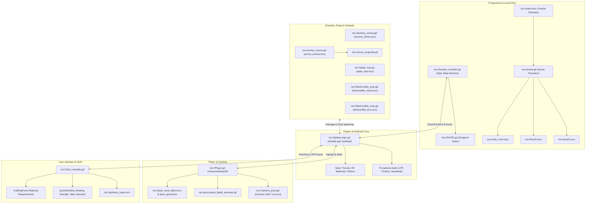

# Panduan Arsitektur & Protokol Pengeditan Proyek DINAMIK (TOXEMIA)

Dokumen ini menyajikan pemahaman menyeluruh terhadap arsitektur, sistem gameplay, dan konvensi teknis game **DINAMIK** (proyek *TOXEMIA*), serta menetapkan **8 Pilar Protokol Baku** yang wajib dipatuhi oleh agen AI saat mengedit, merefaktor, atau menambahkan fitur baru ke dalam proyek.

---

## Bagian 1: Pemahaman Menyeluruh Proyek DINAMIK

### 1. Profil & Pondasi Teknis
- **Nama Game / Proyek**: DINAMIK / TOXEMIA.
- **Engine & Konfigurasi**: Godot Engine 4.6 Stable (Forward Plus / Jolt Physics 3D). Binary terletak di `/opt/godot/Godot_v4.6-stable_linux.x86_64`.
- **Main Scene Entry**: [res://main_menu.tscn](file:///home/g/dinamik/main_menu.tscn) (dikonfigurasi pada [res://project.godot](file:///home/g/dinamik/project.godot)).
- **Autoload Utama**: `GlobalLogic` merujuk ke [res://global_logic.gd](file:///home/g/dinamik/global_logic.gd).

### 2. Mekanika Inti Permainan (Core Mechanics)
1. **Sistem Toksisitas Alkemis (Alchemical Toxicity)**:
   - Toksisitas bertambah setiap kali meminum ramuan: *Healing* (+15), *Strength* (+20), *Slow* (+15), *Berserk* (+35), *Ironskin* (+20).
   - Terdapat 4 tahap toksisitas: `SAFE` (0-30%), `MODERATE` (31-70% - HP decay -2/s), `HIGH` (71-99% - HP decay -5/s), `OVERDOSE` (100% - HP decay -15/s).
   - Modulasi Audio Prosedural: Pada kadar racun tinggi (>75%), filter `AudioEffectLowPassFilter` meredam frekuensi master bus ke frekuensi rendah (muffled audio), sementara `tinnitus_player` (desingan 3.8 kHz) dan `heartbeat_player` (dentuman 55 Hz) memicu ketegangan sensorik.
2. **Sistem Racik Ramuan & Inventori Bahan (Crafting & Inventory)**:
   - Bahan drop dari monster: `slime_gel`, `fire_essence`, `frost_wing`, `goblin_ear`.
   - Menggunakan resep dinamis di [global_logic.gd](file:///home/g/dinamik/global_logic.gd) yang memicu sinyal `inventory_updated` dan `potion_consumed`.
3. **Sistem Tempur & Traversal Pemain ([Player.gd](file:///home/g/dinamik/Player.gd))**:
   - Kombo 3 Tebasan Pedang (*3-Hit Attack Combo*) dengan *lunge motion*, *screen shake trauma*, dan *hit-stop* temporal saat serangan mengenai target.
   - *Target Lock-On (Z-Targeting)* dan *Auto Aim Assist* untuk mengunci sudut pandang kamera ke musuh terdekat.
   - *Aerodynamic Wind Dash*: Lompatan dorong cepat 16 m/s yang memunculkan siluet bayangan ([dash_ghost.tscn](file:///home/g/dinamik/dash_ghost.tscn)), cincin gelombang udara shockwave ([dash_wind_effect.tscn](file:///home/g/dinamik/dash_wind_effect.tscn)), dan audio desau angin prosedural.
   - Pendaratan berbobot dengan partikel hentakan tanah ([ground_slam_shockwave.tscn](file:///home/g/dinamik/ground_slam_shockwave.tscn)) dan debu langkah kaki ([footstep_dust.tscn](file:///home/g/dinamik/footstep_dust.tscn)).
4. **Sistem Musuh, Bahaya, dan Properti Lingkungan**:
   - Slime ([dummy_enemy.gd](file:///home/g/dinamik/dummy_enemy.gd)): Bergerak melompat dinamis, memiliki SubViewport bar darah 3D, dan menjatuhkan loot slime gel.
   - Archer ([archer_enemy.gd](file:///home/g/dinamik/archer_enemy.gd)): AI serangan jarak jauh yang menembakkan proyektil panah ([arrow_projectile.gd](file:///home/g/dinamik/arrow_projectile.gd)).
   - Spike Trap ([spike_trap.gd](file:///home/g/dinamik/spike_trap.gd)): Jebakan lantai berduri berkala yang bisa diabaikan jika buff *Ironskin* aktif.
   - Destructible Props ([destructible_prop.gd](file:///home/g/dinamik/destructible_prop.gd)): Peti dan kotak kayu yang dapat dihancurkan dengan serangan tebasan pedang, memunculkan partikel serpihan kayu ([wood_break_particles.tscn](file:///home/g/dinamik/wood_break_particles.tscn)) dan drop item.
5. **Tutorial State Machine ([tutorial_controller.gd](file:///home/g/dinamik/tutorial_controller.gd))**:
   - Mengatur urutan panduan langkah: `MOVEMENT` -> `PICKUP` -> `CRAFT_HEALING` -> `USE_HEALING` -> `COMBAT` -> `CRAFT_BERSERK` -> `USE_BERSERK` -> `EXIT_PORTAL` -> `COMPLETED`.
   - Mengontrol interaksi pembukaan pintu gerbang ([DOOR.gd](file:///home/g/dinamik/DOOR.gd)) dan aktivasi portal keluar ([portal.gd](file:///home/g/dinamik/portal.gd)).

---

## Bagian 2: 8 Pilar Protokol Pengeditan Proyek

Setiap kali AI assistant memodifikasi file dalam repositori ini, seluruh 8 pilar protokol berikut **wajib** dipatuhi tanpa pengecualian:

```mermaid
flowchart LR
    P1["1. Cek Registry & Gitignore"] --> P2["2. Tentukan Scope (Global vs Local)"]
    P2 --> P3["3. Buat/Edit Scene .tscn (Prefab First)"]
    P3 --> P4["4. Tulis GDScript Bersih & Statis"]
    P4 --> P5["5. Terapkan Standar Anti-Lag"]
    P5 --> P6["6. Jalankan Headless Test"]
    P6 --> P7["7. Update FUNCTIONS_REGISTRY.md"]
    P7 --> P8["8. Kill Background Tasks"]
```

### Pilar 1: Registry-First Development ([FUNCTIONS_REGISTRY.md](file:///home/g/dinamik/FUNCTIONS_REGISTRY.md))
- **Pemeriksaan Awal Wajib**: Sebelum membuat variabel atau fungsi baru, periksa [FUNCTIONS_REGISTRY.md](file:///home/g/dinamik/FUNCTIONS_REGISTRY.md) terlebih dahulu. Jika fungsi/variabel dengan tujuan serupa sudah ada, gunakan kembali dan jangan buat duplikat.
- **Pencatatan Lengkap**: Setiap fungsi/variabel baru wajib dicatatkan dengan format tabel standar:
  - Lokasi file (`res://...`)
  - Nama variabel/fungsi
  - Tipe data & nilai default / Parameter & return type
  - Deskripsi fungsional ringkas (1 kalimat pendek objektif)
- **Larangan Isi Deskripsi**: **DILARANG KERAS** menyisipkan riwayat percakapan chat, revisi, atau instruksi (contoh terlarang: *"sesuai revisi"*, *"murni angka simpel"*, *"sesuai perintah user"*).
- **Git Ignore**: [FUNCTIONS_REGISTRY.md](file:///home/g/dinamik/FUNCTIONS_REGISTRY.md) wajib selalu terdaftar di [.gitignore](file:///home/g/dinamik/.gitignore).

### Pilar 2: Pemisahan Ketat Scope Global vs Lokal
- **Global State ([res://global_logic.gd](file:///home/g/dinamik/global_logic.gd))**:
  - Semua state yang digunakan bersama antar sistem (Toxicity, HP Alkemis, Lantai Dungeon, Inventori Bahan, Jumlah Ramuan, Status Buff Aktif, Sinyal Global Game) wajib diletakkan di Autoload `GlobalLogic`.
- **Local Logic (Skrip Masing-Masing Node)**:
  - Logika khusus node fisik (seperti pergerakan CharacterBody3D pemain, kontroler kamera, AI musuh tertentu, sensor area jebakan) wajib berada di skrip lokal masing-masing node.

### Pilar 3: Arsitektur Berbasis Scene & Prefab (`.tscn`) — Anti-Hardcode
- **Scene/Prefab First**: Seluruh entitas visual, UI, collider, partikel, audio player, dan komponen game **WAJIB** didefinisikan sebagai file Scene Prefab (`.tscn`) atau sub-node scene di editor Godot, **BUKAN** di-instansiasi manual prosedural lewat kode GDScript (`.new()`).
- **Dilarang Prosedural Hardcode**: Hindari membuat hierarki UI atau node 3D secara prosedural di dalam script (seperti `SubViewport.new()`, `ProgressBar.new()`, `MeshInstance3D.new()`, `Area3D.new()`) jika komponen tersebut merupakan bagian tetap dari entitas.
- **Referensi Bersih**: Skrip GDScript bertugas menghubungkan referensi node via `@onready` (atau `%UniqueName`), memproses logika state, dan menggerakkan animasi/properti saat runtime.
- **Modular Spawning**: Objek yang dimunculkan berulang (monster, item drop, proyektil, partikel burst) wajib dibuat sebagai PackedScene prefab tersendiri dan dimunculkan menggunakan `PREFAB.instantiate()`.

### Pilar 4: Standar Anti-Lag & Optimasi Performa (Godot 4 Forward+)
- **SubViewport Bar Darah (`UPDATE_ONCE`)**:
  - Seluruh `SubViewport` offscreen untuk bar darah/billboard 3D **WAJIB** diatur ke `render_target_update_mode = SubViewport.UPDATE_ONCE` secara default di file `.tscn` dan script.
  - Hanya aktifkan ke `UPDATE_ALWAYS` secara temporer saat nilai bar sedang beranimasi/berubah karena damage, lalu kembalikan ke `UPDATE_ONCE` setelah tween selesai.
  - Saat entitas gugur/mati, matikan dengan `UPDATE_DISABLED`.
- **Manajemen Tween & Timer AI**:
  - Hindari penumpukan tween pada properti yang sama tanpa mematikan tween lama terlebih dahulu (simpan referensi seperti `_scale_tween` dan panggil `kill()` sebelum `create_tween()`).
  - Pada state machine AI, selalu patuhi jeda pewaktu (`idle_timer`), dilarang memicu aksi lompat/serangan fisik berulang setiap frame.
- **Efisiensi Geometri Mesh Primitif**:
  - Pada entitas atau partikel yang dimunculkan dalam jumlah jamak (monster, serpihan, letupan cairan), jangan gunakan segmen default berlebih.
  - Batasi `radial_segments` (12–24) dan `rings` (6–12) pada `SphereMesh` / `TorusMesh` untuk mencegah beban poligon berlebih.
- **Caching Resource & Material Statis**:
  - Dilarang mengalokasikan resource identik berulang di memori (seperti `StandardMaterial3D.new()` untuk hit flash atau generator audio WAV di `_ready()`).
  - Wajib gunakan variabel statis (`static var _cached_...`) agar resource dipakai bersama oleh seluruh instance scene.

### Pilar 5: Efisiensi Node Lifecycle & Fisika 3D
- **Spesifikasi Layer & Mask Fisika**:
  - Setiap kali menambahkan node collider/fisik (`CharacterBody3D`, `Area3D`, `StaticBody3D`), wajib menetapkan `collision_layer` dan `collision_mask` secara spesifik sesuai perannya (pemain, musuh, proyektil, lingkungan).
  - Dilarang membiarkan default Layer 1 untuk seluruh objek agar physics server tidak memproses tabrakan massal antar sesama entitas sejenis.
- **Batas Masa Hidup Node Dinamis (TTL & Cleanup)**:
  - Seluruh node yang dimunculkan dinamis (proyektil, floating text, partikel, loot drop) wajib memiliki mekanisme penghapusan otomatis (`queue_free()`) setelah masa hidupnya berakhir.
- **Deaktivasi Sensor & Loop Pasif**:
  - Entitas yang sudah tidak bergerak atau tidak butuh kalkulasi per-frame wajib mematikan pemrosesan dengan `set_physics_process(false)` atau `set_process(false)`.
  - Pada `Area3D` yang pasif/selesai digunakan, matikan `monitoring` dan `monitorable` via `set_deferred()`.
- **Dilarang Query Berat di Loop Frame**:
  - Dilarang menjalankan pencarian node (seperti `get_node()`, `get_tree().get_nodes_in_group()`, atau `find_child()`) di dalam `_process()` atau `_physics_process()`. Seluruh referensi wajib di-cache di awal melalui `@onready`.
- **Efisiensi Pencahayaan Dinamis**:
  - Saat menambahkan lampu dinamis (`OmniLight3D`, `SpotLight3D`), matikan bayangan (`shadow_enabled = false`) kecuali pada sumber cahaya utama level.

### Pilar 6: Konvensi Kode GDScript 4.x
- **Target Godot 4.x**: Gunakan sintaks Godot 4 (misal: `CharacterBody3D`, `@export`, `@onready`, `move_and_slide()` tanpa argumen).
- **Static Typing Penuh**: Seluruh variabel, parameter fungsi, dan return type wajib bertipe eksplisit (`var health: float = 100.0`, `func take_damage(amount: float) -> void:`).
- **`class_name`**: Seluruh skrip jenis objek mandiri wajib mendeklarasikan `class_name` di baris pertama sebelum `extends`.
- **Penamaan**:
  - `snake_case`: Variabel, parameter, nama fungsi, sinyal, nama file script.
  - `PascalCase`: Nama class (`class_name SlimeEnemy`) dan nama node scene.
  - `CONSTANT_CASE`: Konstanta (`const MAX_SPEED: float = 10.0`).
  - Prefix `_`: Variabel dan fungsi internal/private (`var _dash_timer: float = 0.0`, `func _setup_nodes() -> void:`).
- **Gaya Komentar & Dokumentasi**:
  - **Dilarang menggunakan emoji atau emoticon** di dalam komentar kode maupun dokumentasi Markdown.
  - Komentar minimalis dan ringkas, utamakan kode yang *self-explanatory*. Gunakan docstring style Godot (`## ...`) ringkas pada fungsi/variabel publik penting.

### Pilar 7: Eksekusi Headless Testing & Manajemen Background Task
- **Path Binary Godot**: `/opt/godot/Godot_v4.6-stable_linux.x86_64`.
- **Auto-Terminate Wajib pada Pengujian**: Setiap pengujian headless atau runner script wajib menyertakan flag pembatas (misal `--quit-after N`) atau memastikan skrip pengujian memanggil `get_tree().quit(0)` agar proses tidak menggantung tanpa batas di sistem.
- **Pembersihan Proses di Akhir Giliran**: Sebelum menyelesaikan giliran pesan, periksa background task via `manage_task` dan matikan (*kill*) semua proses yang tidak diperlukan.

### Pilar 8: Alur Kerja (Workflow) Edit Step-by-Step
Saat mengeksekusi suatu permintaan perubahan:
1. **Riset & Cek Registry**: Baca `FUNCTIONS_REGISTRY.md` dan file terkait.
2. **Perancangan Plan**: Susun rencana implementasi terperinci (dengan `/plan`).
3. **Penyusunan Scene Prefab (`.tscn`)**: Bangun node struktur visual/fisik di scene prefab terlebih dahulu.
4. **Implementasi GDScript**: Tulis logika dengan static typing dan `@onready` cache.
5. **Pembaruan Registry**: Daftarkan fungsi & variabel baru ke `FUNCTIONS_REGISTRY.md` dengan deskripsi objektif 1 kalimat.
6. **Verifikasi Headless**: Jalankan pengujian headless Godot dan pastikan exit code 0.
7. **Pembersihan Task**: Pastikan tidak ada task menggantung via `manage_task`.

---

## Verifikasi & Status Kesiapan

- [x] Deteksi path Godot 4.6 Linux: `/opt/godot/Godot_v4.6-stable_linux.x86_64` (Terverifikasi berjalan normal).
- [x] Verifikasi struktur registry: [FUNCTIONS_REGISTRY.md](file:///home/g/dinamik/FUNCTIONS_REGISTRY.md) (26 controller & prefabs terdaftar).
- [x] Verifikasi aturan [.gitignore](file:///home/g/dinamik/.gitignore): `FUNCTIONS_REGISTRY.md` dan `.godot/` diabaikan oleh Git.
- [x] Seluruh background task dicek dan bersih.
